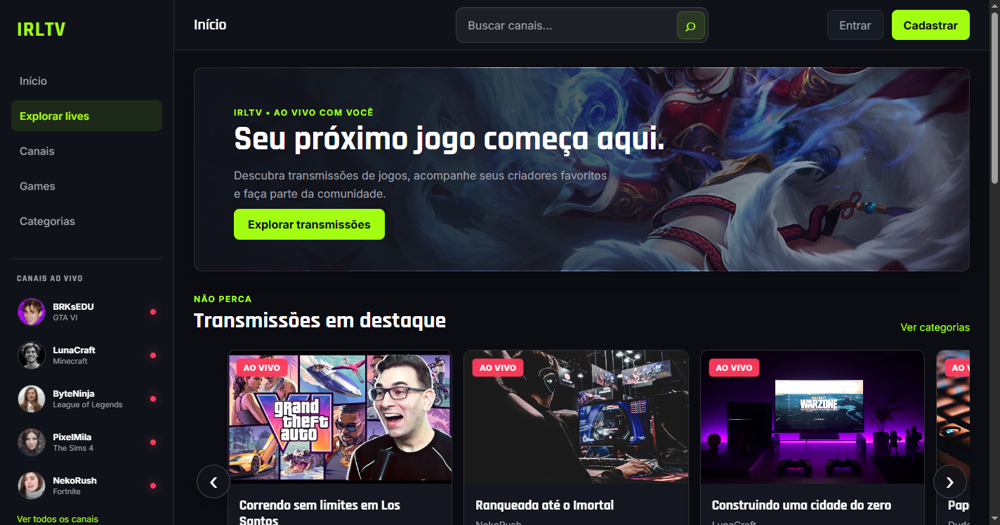
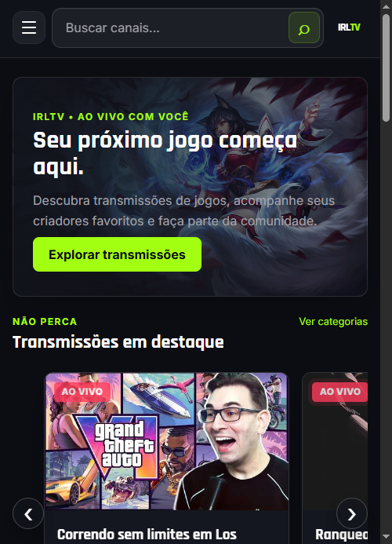
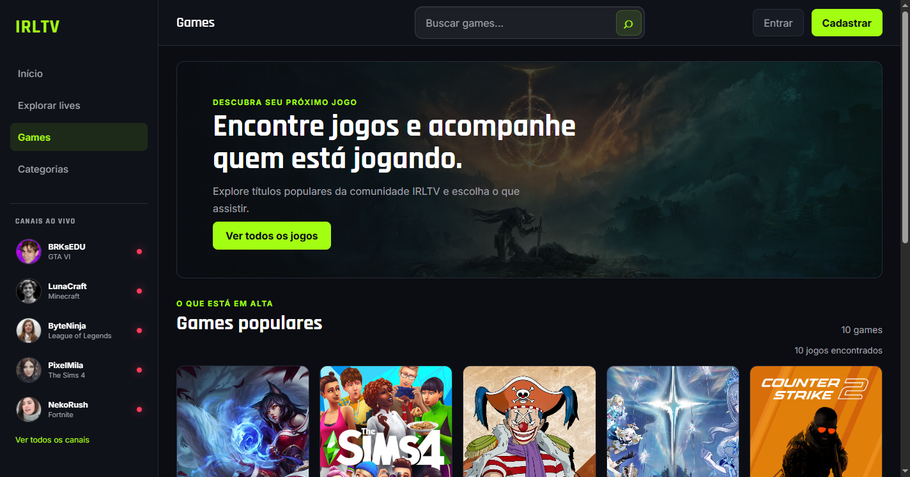
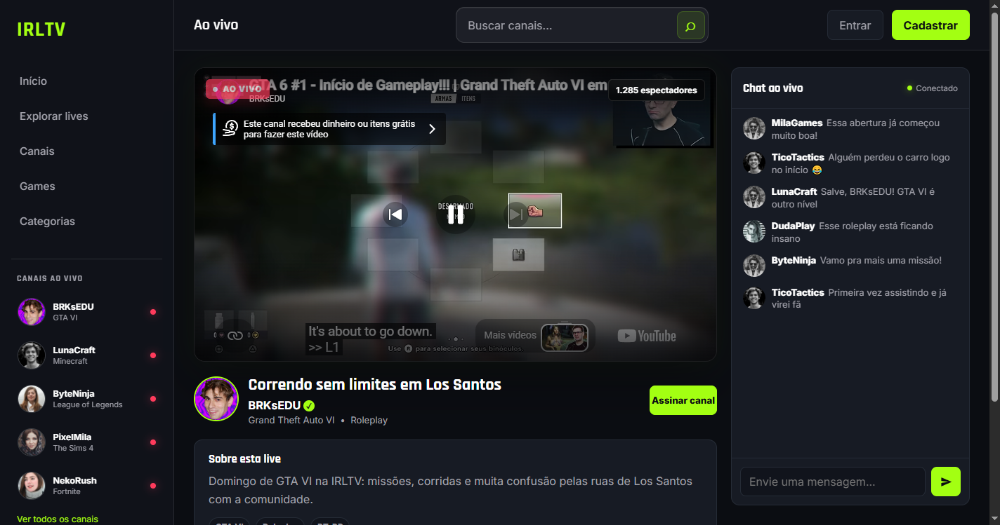
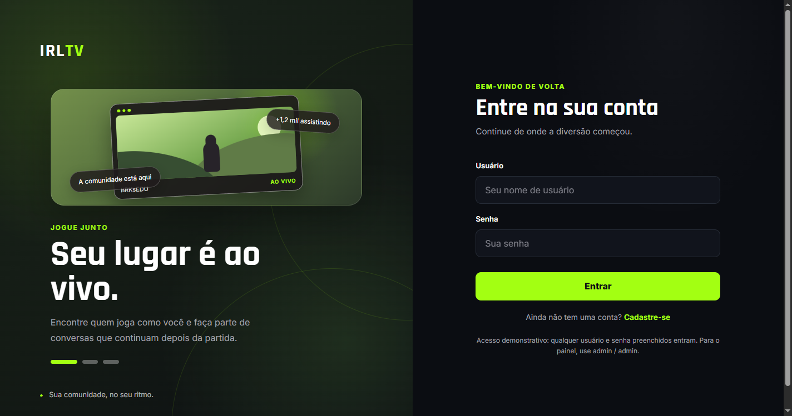
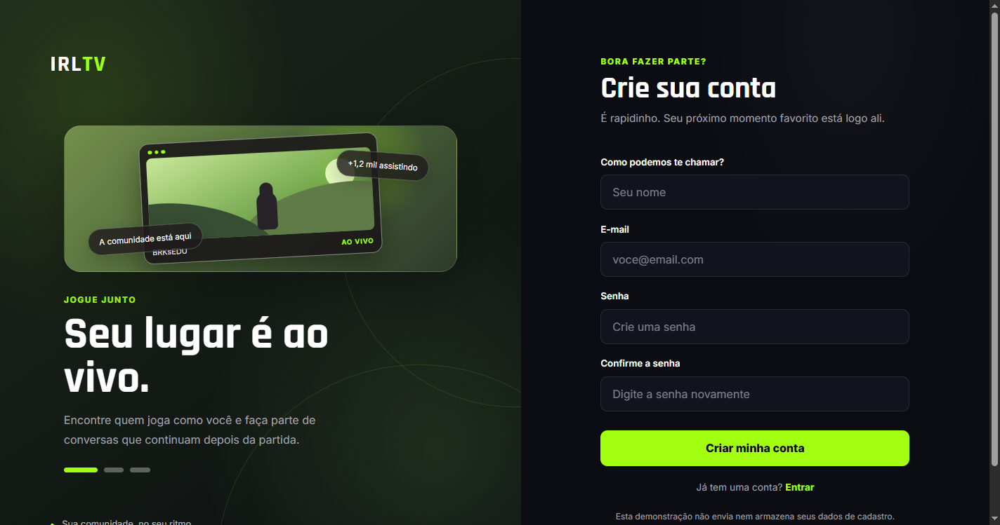
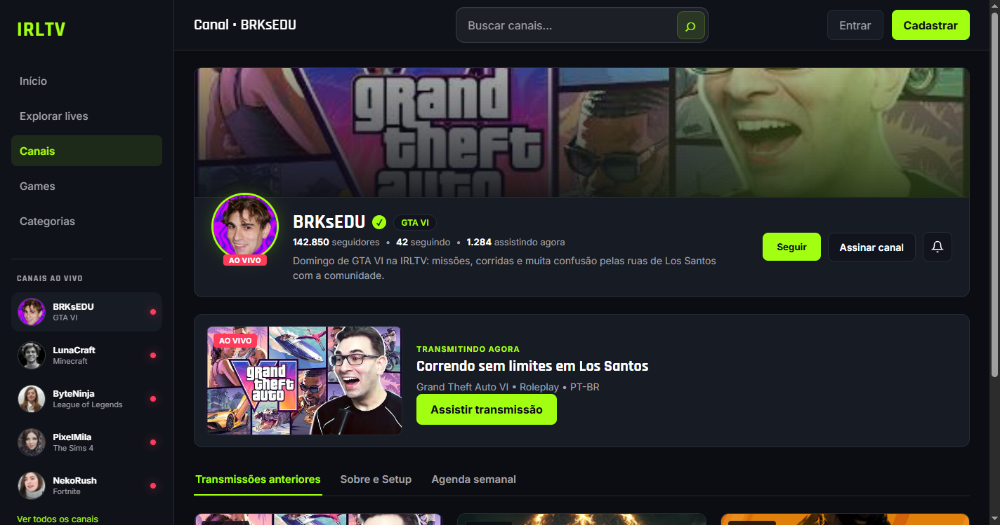
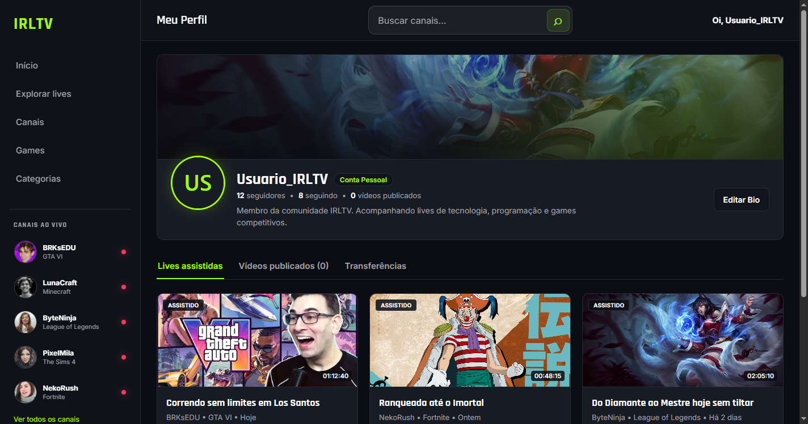
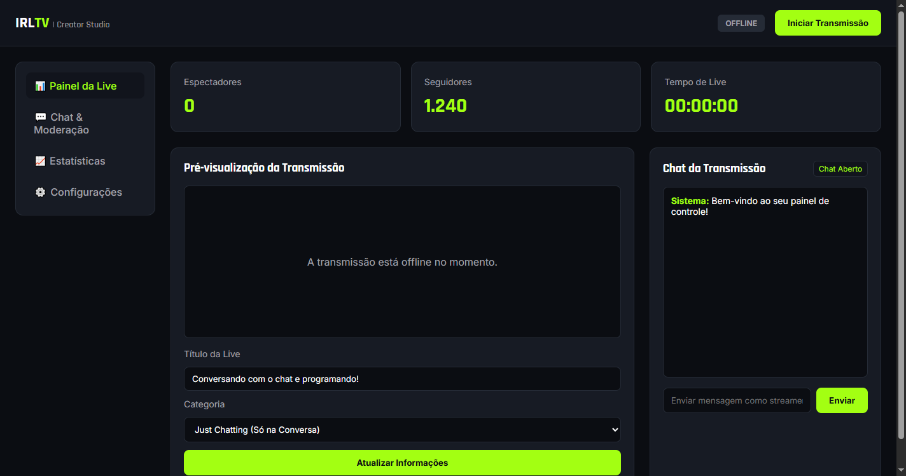

# IRLTV

## Live Stream Platform

Aplicação IRLTV: plataforma de lives de jogos.

**Demonstração hospedada:** https://irltv.kaioborges.com.br/

## Equipe

- Kaio Araujo Borges
- Natã Rigueira Pains Lemos
- Bruno dos Santos Cardoso
- Arthur Maracajá Carvalho
- Pedro Henrike Morais Caetano Mendes

## Objetivo geral

Desenvolver uma aplicação web para a plataforma de lives de jogos IRLTV, integrando:

- Interface responsiva com HTML, CSS e JavaScript
- Demonstração de páginas de lives, jogos, perfis e autenticação
- Deploy da aplicação em plataforma de hospedagem na nuvem
- Controle de versão com participação individual comprovada via Git/GitHub
- Organização de transmissões, canais, categorias e jogos

## Tema escolhido

Desenvolvimento de uma plataforma web de transmissões ao vivo de jogos (IRLTV).

## Problema do negócio

A dificuldade de organizar e acompanhar as transmissões, os espectadores e o engajamento da plataforma dificulta a identificação dos conteúdos mais populares e dos fatores que influenciam a audiência.

## Perguntas do negócio e respostas da versão atual

### Quais categorias de jogos possuem maior número de espectadores?

A interface apresenta categorias como GTA VI, Minecraft, League of Legends, The Sims 4, Fortnite e Just Chatting. Como não existem métricas persistidas nem coleta automática, não é possível afirmar qual categoria possui mais espectadores; os números exibidos são dados demonstrativos.

### Quais horários apresentam maior audiência nas transmissões?

A versão atual não registra horários nem audiência ao longo do tempo. O perfil de canal apresenta uma agenda semanal visual, mas não utiliza dados históricos.

### Quais streamers possuem maior número de visualizações?

A página inicial apresenta uma seleção de canais e contagens demonstrativas. Não há banco de dados ou medição real para calcular o ranking dos streamers.

### Quais transmissões apresentam maior engajamento dos espectadores?

O projeto demonstra elementos de engajamento, como chat, superchat, seguidores e quantidade de espectadores. Esses dados não representam resultados reais.

### Quais categorias conseguem manter os espectadores por mais tempo?

Ainda não há retenção histórica ou análise de permanência na plataforma. A resposta exige coleta de sessões e métricas futuras com backend e banco de dados.

## Regras de negócio

- **Transmissões:** apresentar lives organizadas por jogo, categoria, canal e quantidade demonstrativa de espectadores.
- **Canais:** cada canal deve ter identificação, categoria, foto, descrição, transmissão atual, conteúdo publicado e agenda de lives.
- **Jogos:** permitir localizar títulos pelo nome ou gênero e apresentar uma página vazia quando não houver resultado.
- **Navegação:** permitir navegar entre início, explorações, canais, jogos, live, perfil, login e cadastro.
- **Busca:** filtrar ou encaminhar o usuário sem recarregar indevidamente os dados da página.
- **Login demonstrativo:** qualquer usuário e senha preenchidos concluem o acesso demonstrativo. A combinação `admin / admin` representa uma tentativa de acesso ao painel administrativo.
- **Cadastro demonstrativo:** validar campos obrigatórios e confirmar que a senha coincide com a confirmação antes do retorno à tela de login.
- **Chat:** aceitar mensagens digitadas e exibir novas mensagens no chat da sessão.
- **Apoio à live:** permitir selecionar um valor demonstrativo e enviar uma mensagem de superchat.
- **Perfil:** identificar o usuário pelo nome salvo na sessão atual e apresentar áreas de histórico, vídeos e transferências.

## Tecnologias utilizadas

- **HTML5:** estruturação das páginas, formulários, vídeos, links e conteúdo semântico.
- **CSS3:** estilização, responsividade, menus, cards, temas visuais, estados e layouts.
- **JavaScript:** interação da interface, busca de jogos, menu móvel, slider, autenticação demonstrativa, chat, superchat e controles da live.
- **YouTube Embed / YouTube IFrame API:** exibição da transmissão incorporada e controle de reprodução, volume e tela cheia.
- **Git e GitHub:** controle de versões e participação individual no desenvolvimento.
- **Hospedagem web:** publicação dos arquivos estáticos em plataforma de hospedagem na nuvem.

O projeto atual é uma aplicação web estática. Não possui backend próprio, API REST, banco de dados ou autenticação real. O login, o cadastro e o nome da sessão são demonstrações implementadas no navegador.

## Estrutura da aplicação

- `index.html`: página inicial, destaques, canais, jogos e categorias.
- `jogos.html`: catálogo de jogos populares e busca.
- `live.html`: player, chat, superchat, detalhes e controles da transmissão.
- `login.html`: acesso demonstrativo.
- `register.html`: cadastro demonstrativo.
- `perfil.html`: perfil público do streamer.
- `usuario.html`: perfil pessoal do usuário.
- `dashboard.html`: painel demonstrativo do criador.
- `css/`: folhas de estilo separadas por estrutura global, menus, páginas e perfis.
- `js/`: scripts separados por autenticação, navegação, conteúdo, jogos e live.

## Interface e responsividade

- Interface organizada em barras lateral e superior, área principal, cartões e seções.
- Layout adaptado para desktop e celular por meio de CSS responsivo e menu móvel.
- Componentes visuais: hero, cards, carrossel, barra de busca, abas, formulários e mensagens de estado.
- Estados visuais para login, cadastro, seleção de transmissão, chat e envio de apoio.
- Feedback visual em validações, resultados de busca, mensagens enviadas e mudanças de estado.

## Componentização

- **Estrutura global:** cabeçalho, barra lateral, menu móvel, busca e ações de conta.
- **Página inicial:** hero, carrosséis, cards de lives, cards de canais, games e categorias.
- **Página de live:** player, barra de informações, chat, superchat e controles.
- **Página de jogos:** hero, toolbar, grid de cards, estado vazio e busca.
- **Autenticação:** slider informativo, formulário de login, cadastro e feedback.
- **Perfis:** capa, avatar, estatísticas, abas, conteúdo publicado e agenda.
- **Dashboard:** painel da live, moderação, estatísticas e configurações do criador.

## Persistência de dados

Nesta versão, não existe banco de dados nem persistência permanente pelo servidor. O nome do usuário é mantido temporariamente na `sessionStorage` da aba durante a navegação. Conteúdos de lives, jogos, canais e perfis são definidos diretamente no HTML ou em estruturas JavaScript da interface.

## Feedback visual e UX

- Mensagens de feedback no login e cadastro.
- Estados de validação para campos obrigatórios e confirmação de senha.
- Estado vazio quando nenhum jogo corresponde à busca.
- Mensagens acrescentadas ao chat e ao superchat da live.
- Mudanças visuais de seguir, assinar, notificações e seleção de abas.
- Menu móvel, slider e carrosséis com estados acessíveis.

## Dashboard e indicadores

A aplicação possui um dashboard do criador acessível pela combinação demonstrativa `admin / admin` na tela de login. A página `dashboard.html` contém:

- **Painel da Live:** espectadores, seguidores, tempo da transmissão, pré-visualização, título, categoria e chat do streamer.
- **Chat & Moderação:** modo lento, chat exclusivo para seguidores, filtro de palavras ofensivas, limpeza do histórico e ações de timeout/banimento.
- **Estatísticas:** pico de espectadores, novos seguidores, horas transmitidas e gráfico de média de espectadores por semana ou mês.
- **Configurações:** chave de transmissão simulada, qualidade de saída, modo de latência e opção de salvar VOD.

Os valores, gráficos, usuários, mensagens e ações do dashboard são demonstrativos. Não há painel administrativo protegido, API, banco de dados ou integração com OBS, Streamlabs, YouTube ou outra plataforma de transmissão.

## Segurança e autenticação

A segurança real não foi implementada porque o projeto não possui backend. O login aceita usuários demonstrativos e não cria nem valida uma conta. A combinação `admin / admin` redireciona para o dashboard demonstrativo. Portanto, não deve ser apresentada como autenticação segura ou área administrativa protegida.

## Deploy da aplicação

URL da demonstração: https://irltv.kaioborges.com.br/

O projeto utiliza arquivos estáticos de HTML, CSS e JavaScript e pode ser publicado em plataformas de hospedagem web.

## Testes realizados

- Execução das páginas em servidor local.
- Verificação da navegação entre início, jogos, live, login, cadastro, perfis e dashboard.
- Captura de telas em tamanho desktop e celular.
- Verificação visual da responsividade da página inicial.
- Teste manual da busca de jogos pelo nome ou gênero.
- Revisão da consistência das regras visuais e dos estados de interface.

## Limitações da versão atual

- Sem API REST própria.
- Sem backend próprio.
- Sem banco de dados.
- Sem autenticação ou autorização reais.
- Sem painel administrativo protegido ou integrado ao servidor.
- Sem persistência permanente de chat, cadastro ou conteúdo.
- Sem métricas reais de audiência e engajamento.

## Conclusão

A versão atual do IRLTV demonstra uma interface web responsiva para uma plataforma de lives de jogos. Foram implementadas páginas de início, catálogo de jogos, transmissão ao vivo, login, cadastro e perfis. JavaScript foi utilizado para interações, navegação, busca e demonstrações de chat e superchat.

Como não foram implementados backend, API, banco de dados e autenticação segura, esta entrega representa o protótipo front-end da plataforma e não um sistema completo de produção.

## Trabalhos futuros

- Implementar backend e API REST.
- Adicionar banco de dados para usuários, canais, lives e mensagens.
- Criar autenticação segura e controle de sessões.
- Desenvolver painel administrativo.
- Registrar audiência e engajamento em tempo real.
- Publicar o projeto no diretório público da hospedagem.
- Adicionar testes automatizados e monitoramento.

## Capturas da aplicação

### Página inicial

### Página inicial em celular

### Página de jogos

### Página da transmissão ao vivo

### Página de login

### Página de cadastro

### Perfil do streamer

### Perfil pessoal

### Dashboard do criador

